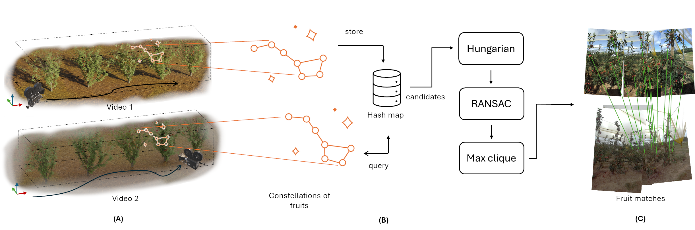
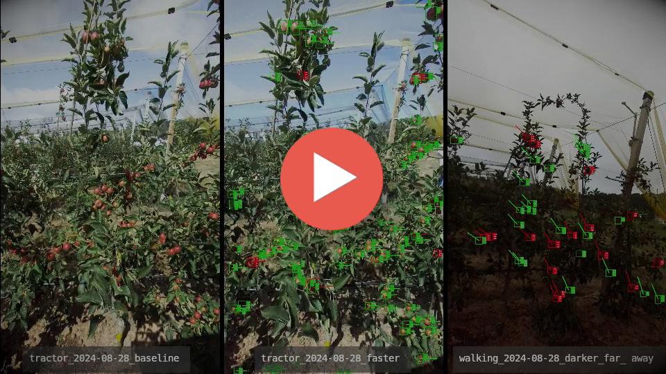

# How to rewrite the stars: Mapping your orchard over time through constellations of fruits

This page contains the supplemental material associated to the paper with the same name, by Gonçalo P. Matos, Carlos Santiago, João P. Costeira, Ricardo L. Saldanha and Ernesto M. Morgado.

# What is it?

A geometric hashing system to fingerprint fruits in an orchard, allowing for re-identification of fruits, tracking them over time, or mapping and localisation in unstructured environments.

## Abstract

Following crop growth through the vegetative cycle allows farmers to predict fruit setting and yield in early stages, but it is a laborious and non-scalable task if performed by a human who has to manually measure fruit sizes with a calliper or dendrometers. 
In recent years, computer vision has been used to automate several tasks in precision agriculture, such as counting fruits and estimating their size. 
However, the fundamental problem of matching fruits from one video to another, collected on a later date, which is needed to track fruits' growth through time, remains to be solved. Few attempts were made, but either they assumed that the camera always starts from the same known position and that there are sufficiently distinct visual features to match, or they used other data sources, like GNSS.
Here we propose a new paradigm to tackle this problem, based on constellations of 3D fruit centroids, and introduce a descriptor for very sparse 3D point clouds that can be used to match fruits across videos. Matching constellations instead of individual fruits is key to deal with non-rigidity, occlusions, and challenging imagery with few distinct visual features to track.
The results show that the proposed method can be successfully used to match fruits across videos and through time, and also to build an orchard map and later use it to locate the camera pose in 6DoF, thus enabling, for example, autonomous navigation of robots in the orchard or selective fruit picking.

# Video

# Dataset

To be released...

